  

# Hello there, I'm Torin

Security engineer at [ControlPlane](https://control-plane.io). I work on agentic security in regulated industry, mostly fintech: building the platform agents run on and red teaming them in a sandbox before they reach production.

  

<a href="https://torinvdb.github.io/torinvdb/">Open the nav computer</a> to explore the chart. The same work is listed below.

## Work

<!-- nav:start -->
### AI red teaming

- **GPT-4o** (Pre-release model, 2024): [System card](https://openai.com/index/gpt-4o-system-card/), [Case study](https://control-plane.io/case-studies/openai-red-teaming/)
- **Operator** (Computer-using agent, 2025): [System card](https://openai.com/index/operator-system-card/), [Case study](https://control-plane.io/case-studies/openai-red-teaming/)
- **o3-mini** (Reasoning model, 2025): [System card](https://openai.com/index/o3-mini-system-card/), [Case study](https://control-plane.io/case-studies/openai-red-teaming/)
- **Deep Research** (Research agent, 2025): [System card](https://openai.com/index/deep-research-system-card/), [Case study](https://control-plane.io/case-studies/openai-red-teaming/)
- **Wild West I** (Blog post): [Read it](https://control-plane.io/posts/ai-red-teaming-wild-west-part-1/)
- **Wild West II** (Blog post): [Read it](https://control-plane.io/posts/ai-red-teaming-wild-west-part-2/)

### Agentic systems

- **Agent runtime** (Platform engineering): Build and operate the runtime AI agents execute on at financial services clients: sandboxed execution, scoped identities and tool permissions, and the SRE work that keeps agent workloads observable and recoverable on Kubernetes.
- **AI Security training** (Course author and lead trainer, 2026): Author and lead ControlPlane's AI Security training. The agent sandboxing content was built with Docker, who sponsored the 2026 North America roadshow, starting in Toronto and New York.
- **A Game of Ethics** (Open source eval harness, 2026): [Repository](https://github.com/torinvdb/a-game-of-ethics)
- **DynastAI** (GRPO demo): [Repository](https://github.com/torinvdb/DynastAI-Demo)

### AI governance

- **FINOS AI Governance** (Industry framework): [Framework](https://air-governance-framework.finos.org/)
- **FINOS AI Readiness** (Industry framework): [Repository](https://github.com/finos/ai-readiness)
- **AI Governance Framework** (Open source): [Repository](https://github.com/torinvdb/ai-governance-framework)

### DevSecOps and supply chain

- **VEX remediation** (Supply chain security): Scanners produce more findings than any team can triage. I operationalize VEX so a finding comes with a statement about whether it's exploitable in that build, then use agentic remediation and sandboxed red teaming to work the ones that are.
- **Argo CD threat model** (CNCF end user threat model, 2023): [Threat model](https://github.com/argoproj/argoproj/blob/main/docs/end_user_threat_model.pdf), [Case study](https://control-plane.io/case-studies/the-linux-foundation-security-considerations-for-hardening-declarative-gitops-cd-on-kubernetes/)
- **Repo-server RCE** (Write-up, 2026): [Read it](https://control-plane.io/posts/argo-cd-repo-server-rce/)

### Cloud native

- **Envoy Gateway threat model** (CNCF end user threat model): [Threat model](https://gateway.envoyproxy.io/docs/tasks/security/threat-model/), [Blog post](https://control-plane.io/posts/envoy-gateway-threat-model/)
- **EKS at Citi** (Security architecture): [Case study](https://control-plane.io/case-studies/citigroup-security-architecture-and-engineering-for-eks/)

### Zero Trust

- **SPIFFE and SPIRE** (Linux Foundation course, LFS482): [Course](https://training.linuxfoundation.org/training/zero-trust-security-with-spiffe-and-spire-lfs482/), [Case study](https://control-plane.io/case-studies/linuxfoundation-zero-trust-courseware/)
- **Intro to Zero Trust** (Linux Foundation course, LFS183): [Case study](https://control-plane.io/case-studies/linuxfoundation-zero-trust-courseware/)
- **High assurance at NIST** (Conference write-up, 2023): [Read it](https://control-plane.io/posts/cp-at-nist-con-2023/)
<!-- nav:end -->
